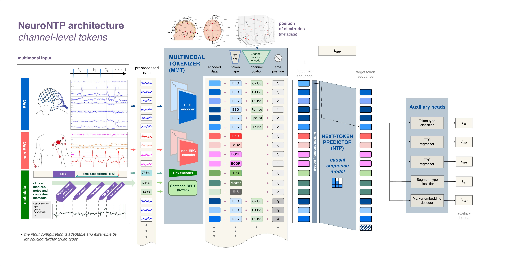

# NeuroNTP: A Generalizble Multimodal Foundation Model for Epilepsy


> [!NOTE]
> **Release status:** The environment setup and dataset preprocessing tools are available now. The full code release is in progress and will be published soon.

NeuroNTP is a PyTorch framework for multimodal self-supervised learning on biosignals. It has two main components:

- **Multimodal tokenizer:** an extensible encoder that maps signals such as EEG, ECG and SpO2 into a shared embedding space.
- **Next-token predictor:** a causal sequence model, configurable as an xLSTM, Transformer, Linear Transformer or Mamba.

Pretraining is driven by next-token prediction, with auxiliary tasks in a multitask head acting as regularisers.

Within each timestep, the embeddings are arranged as a subsequence of channel-level tokens. This forms one continuous token stream, so the model learns to predict the next embedding from the history of channel-level tokens.



## Setting up the environment

Customise the nntp.env file in the project root folder to match your environment.

### Installation

NeuroNTP is installed as a Python package (`neuro_ntp`) inside a dedicated conda environment. From the repository root, run:

```bash
conda env create -f environment.yml
conda activate neurontp
```

This creates the `neurontp` environment and installs the package in editable mode, together with all its dependencies. Activate the environment before running any of the preprocessing, training or evaluation scripts.

## Preparing the datasets

NeuroNTP uses a self-supervised dataset implementation built on our `EpilepsiaCoreDataset` / `EpilepsiaDatasetView` classes, so the data must first be preprocessed into a compatible format.

The [data preparation guide](src/neuro_ntp/data/README.md) has preprocessing instructions for the TUH EEG Seizure Corpus, CHB-MIT and the Siena Scalp EEG Database. It also explains how to prepare your own dataset for use with NeuroNTP.

### Pretrained model weights

The weights of the model pretrained on the Kepler Universitätsklinikum (KUK) dataset are available [here](https://cloud.ml.jku.at/s/Fs3sz2R7oWs6b6C). 

### Multi-GPU training

Currently, the pretraining code is compatible with single GPU training only, multi-GPU is not supported.