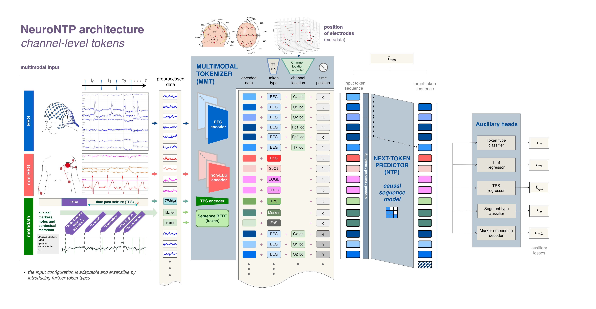

# NeuroNTP: A Generalizable Multimodal Foundation Model for Epilepsy

[](https://neurips.cc/virtual/2026/poster/149129)
[](https://openreview.net/forum?id=seM8LkgKy6)
[](https://cloud.ml.jku.at/s/Fs3sz2R7oWs6b6C)
[](LICENSE)


> [!NOTE]
> **Release status:** The environment setup and dataset preprocessing tools are available now. The full code release is in progress and will be published soon.

NeuroNTP is a PyTorch framework for multimodal self-supervised learning on biosignals. It has two main components:

- **Multimodal tokenizer:** an extensible encoder that maps signals such as EEG, ECG and SpO2 into a shared embedding space.
- **Next-token predictor:** a causal sequence model, configurable as an xLSTM, Transformer, Linear Transformer or Mamba.

Pretraining is driven by next-token prediction, with auxiliary tasks in a multitask head acting as regularisers.

Within each timestep, the embeddings are arranged as a subsequence of channel-level tokens. This forms one continuous token stream, so the model learns to predict the next embedding from the history of channel-level tokens.

<picture>
  <source media="(prefers-color-scheme: dark)" srcset="./res/nntp_architecture_channel_dark.png">
  
</picture>

## Results on public benchmarks

Seizure detection on CHB-MIT and Siena Scalp EEG. NeuroNTP is pretrained multimodally on the KUK dataset, then fine-tuned and evaluated with biosignal-only input (no clinical markers, notes or TPS). Values are means in %; best per column in bold.

| Model | CHB-MIT BACC | CHB-MIT AUPRC | CHB-MIT AUROC | Siena BACC | Siena AUPRC | Siena AUROC |
|---|---:|---:|---:|---:|---:|---:|
| CNN-Transformer | 63.9 | 24.8 | 86.6 | 69.8 | 38.4 | 87.2 |
| BIOT | 70.7 | 32.8 | 87.6 | 73.5 | 38.1 | 90.3 |
| LaBraM-Base | 70.8 | 32.9 | 86.8 | 70.8 | 31.2 | 88.1 |
| CBraMod | 74.0 | 36.9 | 88.9 | 73.2 | 41.1 | 90.4 |
| EEGMamba | 74.5 | 38.9 | 89.4 | – | – | – |
| CSBrain | 72.6 | **51.6** | 89.2 | 76.6 | **48.7** | 90.8 |
| **NeuroNTP (ours)** | **84.7** | 45.4 | **93.8** | **87.5** | 46.6 | **93.6** |

Baseline results are taken from [CBraMod](https://arxiv.org/abs/2412.07236) (CHB-MIT) and [CSBrain](https://arxiv.org/abs/2506.23075) (Siena), and we follow their evaluation protocols. The paper has the full tables, including standard deviations and further baselines.

## Setting up the environment

Customise the nntp.env file in the project root folder to match your environment.

### Installation

NeuroNTP is installed as a Python package (`neuro_ntp`) inside a dedicated conda environment. From the repository root, run:

```bash
conda env create -f environment.yml
conda activate neurontp
```

This creates the `neurontp` environment and installs the package in editable mode, together with all its dependencies. Activate the environment before running any of the preprocessing, training or evaluation scripts.

## Preparing the datasets

NeuroNTP uses a self-supervised dataset implementation built on our `EpilepsiaCoreDataset` / `EpilepsiaDatasetView` classes, so the data must first be preprocessed into a compatible format.

The [data preparation guide](src/neuro_ntp/data/README.md) has preprocessing instructions for the TUH EEG Seizure Corpus, CHB-MIT and the Siena Scalp EEG Database. It also explains how to prepare your own dataset for use with NeuroNTP.

### Pretrained model weights

The weights of the model pretrained on the Kepler Universitätsklinikum (KUK) dataset are available [here](https://cloud.ml.jku.at/s/Fs3sz2R7oWs6b6C). 

### Multi-GPU training

Currently, the pretraining code is compatible with single GPU training only, multi-GPU is not supported.

## Citation

If you found this work useful, please cite our paper:

```bibtex
@inproceedings{kovacs2026neurontp,
  title     = {{NeuroNTP} - A Generalizable Multimodal Foundation Model for Epilepsy},
  author    = {Kov{\'a}cs, J{\'o}zsef and Hauser, Amadeus and Gr{\"o}ppel, Gudrun and Narzt, Wolfgang and Seidl, Philipp},
  booktitle = {Advances in Neural Information Processing Systems (NeurIPS)},
  year      = {2026},
  url       = {https://openreview.net/forum?id=seM8LkgKy6}
}
```
